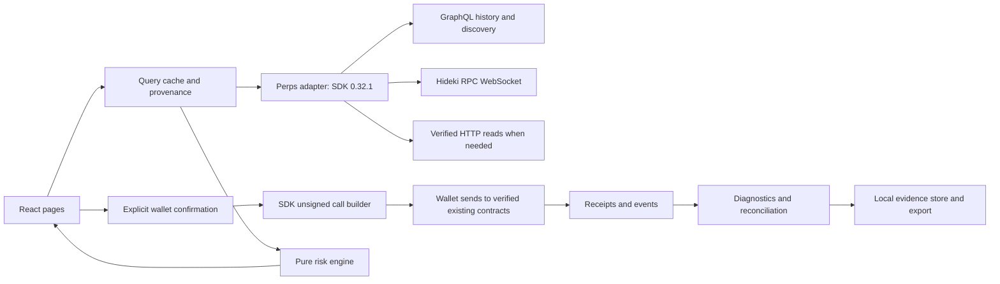

# Perps Execution Inspector — implementation plan for review

Status: **Historical architecture baseline, now implemented in reviewable parts.** Follow [BUILD_PARTS.md](BUILD_PARTS.md) for current status and acceptance gates. The shipped stack uses React/Vite/TypeScript, viem plus an injected/EIP-6963 wallet adapter, the pinned markets SDK, TanStack Query, React Router, CSS and Playwright. Two npm workspaces and versioned localStorage journals were sufficient; wagmi, Vitest, fast-check and IndexedDB below remain original proposals rather than installed dependencies. No new smart contracts were introduced.

Read [source verification](SOURCE_VERIFICATION.md), [capability matrix](CAPABILITIES.md), [testing](TEST_PLAN.md), [security](SECURITY.md) and [submission checklist](SUBMISSION_CHECKLIST.md) alongside this plan.

## Architecture and technical stack

Use a static **React + Vite + TypeScript** application, **wagmi + viem** for wallet connectivity, **@somnia-chain/markets-sdk pinned to 0.32.1** for protocol integration, **TanStack Query** for bounded query caching, **React Router** for routes, and Tailwind/CSS plus accessible component primitives. Use **Vitest**, **fast-check** and **Playwright** for unit/property/UI tests. Resolve compatible current UI dependencies and commit their exact lockfile during implementation.

Use npm workspaces for three small shared packages because precision, protocol and diagnostic logic need independently testable boundaries. Node is development/test tooling, not a custody server. The MVP needs no FastAPI, SQL backend, AI service, new contracts or always-on bot worker. Store sanitized attempts in IndexedDB with schema versioning, retention controls, JSON export/import and a clear warning that local browser storage is not durable archival storage.



The HTTP node must match chain ID and genesis. It is an explicit fallback for selected verified reads and receipts; the SDK itself has no HTTP fallback. Streaming hydration is not yet proven, so a live stream must not be a dependency of order signing or receipt inspection.

## Planned files and responsibilities

These are planned application files, not existing implementation:

```text
package.json, package-lock.json, tsconfig.base.json, .gitignore, .env.example
apps/web/src/app/{App,router,providers}.tsx
apps/web/src/pages/{Overview,Markets,Trade,ExecutionInspector,PositionsRisk,
                    History,TestLab,Settings}.tsx
apps/web/src/components/{AppShell,AccountBar,NetworkGuard,SourceBadge,
  ConnectionStatus,MarketTable,OrderBook,OrderForm,PreflightPanel,
  ConfirmationDialog,ExecutionTimeline,ReceiptPanel,PositionTable,
  RiskScenarioEditor,HistoryTable,TestRunPanel,EvidenceExport}.tsx
apps/web/src/storage/{attempts,schema}.ts
packages/perps-adapter/src/{config,client,discovery,snapshots,units,
  preflight,ownerExecution,receipt,reconciliation,health,capabilities}.ts
packages/perps-adapter/src/abi/verified-reads.ts
packages/risk-engine/src/{scenarios,portfolio,rounding,assumptions}.ts
packages/diagnostics/src/{attempt,errorTaxonomy,decode,redact,export}.ts
tests/{unit,property,integration,e2e}/
README.md, LICENSE
```

Add delegated execution, native stops and margin-management modules only in the phase that implements them. Add `feedback/` only for actual public reports, not empty speculative issues. The existing research documents remain the baseline; update feature statuses with proof as implementation proceeds.

## Pages, components and user workflows

Shared shell: fixed navigation, independently scrolling content, network/TESTNET badge, active owner and signer displayed separately, data-source/age badges, live/indexer/HTTP status, accessible dialogs and keyboard navigation. Use the same layouts on mobile with horizontally scrollable tables. Every metric has units and an unavailable/stale/error state.

| Route | Components and detailed workflow |
|---|---|
| `/` Overview | AccountBar, health cards, wallet versus margin/voucher balances, all-position count, pending-order count, five recent local executions. Enter a public account or connect read-only → verify network/config → discover account's active pools → load partial results with coverage → choose Inspect, Trade or Risk. Disconnected mode still shows network/market health. Never summarize missing data as a healthy empty account |
| `/markets` | Search/filter/sort MarketTable, market drawer, risk parameters, freshness badges, bounded OrderBook. Discover dynamic markets → inspect decimals/grid/limits/mark/index/funding → select market → open composer. Show effective leverage and eligibility distinctly; a read-only viewer without an account gets unknown account eligibility |
| `/trade/:pool` | OrderForm, side/type/TIF inputs, decimal inputs, notional/depth estimate, preflight gates, gas/approval disclosure, ConfirmationDialog. Choose market → enter order → validate precision → fetch current account/market state → preview capacity and requested margin → build and simulate exact call → review → one explicit wallet action → immediately open attempt timeline. No send on page load or retry effect |
| `/executions` and `/executions/:attemptId` | Attempt list, ExecutionTimeline, ReceiptPanel, decoded events, indexed/chain comparison, failure explanation, raw sanitized JSON, export. Select attempt → compare expected and actual → inspect signer/pool/order/fills/gas → retry reads or cancel a proven resting order with a new confirmation. Never offer an automatic resubmit after an unknown outcome |
| `/positions` | PositionTable, account-level collateral/equity/margin cards, orders consuming margin, per-position entry/mark/PnL/funding/leverage. Enumerate all active pools and indexed positions → reconcile with chain → retain unpriceable/unknown rows → choose Inspect, simulate a scenario, or later an owner-native stop. Whole-account sums count shared collateral once |
| `/positions/risk` | RiskScenarioEditor, scenario comparison table/chart, assumptions and coverage panel. Load a consistent snapshot → choose ±1/3/5/10% uniform shock or per-market values → optionally add a hypothetical order/funding interval → calculate equity/MM/headroom changes → export scenario with snapshot. Changes remain local and never alter positions |
| `/history` | HistoryTable, account/date/market/type filters, coverage bounds, cursor/offset page controls, CSV/JSON/Markdown export. Separate this browser's attempts from indexed account activity → load bounded pages → compare receipt if available → report fill/reject/slippage metrics only where denominators and sample coverage are known |
| `/test-lab` | TestRunPanel with read-only and transaction suites, prerequisites, input/expectation/evidence/result. Run safe read-only checks → inspect pass/fail/inconclusive → select a controlled transaction scenario only after reviewing costs/owner/market → sign each authorized action → export one reproducible report. No flood or unrelated-wallet tests |
| `/settings` | Network/config manifest, SDK version, account/signer role, data health, retention/export controls, locally chosen display thresholds, official funding/linking links. Endpoint edits invalidate verification and disable writes until checked. Disconnect removes signer and account caches; local history remains segregated by account and chain |

Native TP/SL and linked-bot controls are conditional capabilities. Ordinary-order reduce-only is not represented as implemented. No false switches or permanently active buttons for unimplemented features.

## Primary execution workflow

1. **Identify:** selected chain/genesis/config, owner, actual signing actor, pool and quote collateral. EOA owner trades its own account. A dreamDEX app smart-account address is not interchangeable with the connected login EOA.
2. **Discover:** resolve current market metadata and verify factory registration, bank, token decimals and grid. Mark stale indexer rows and use canonical chain parameters for signing.
3. **Parse:** accept decimal strings, convert to bigint, require tick/lot alignment and minimum size. Any proposed adjustment requires visible acceptance. Expiry uses nanoseconds. Determine GTC/IOC/FOK/ALO using the verified enum mapping.
4. **Snapshot:** read current mark/index, book, account and positions, restrictions, voucher and gas balance. Record block and timestamps. Read failures block a trade when they affect required guarantees.
5. **Preflight:** `getMaxPerpOrderSize` followed by `previewPerpOrderMargin` for the requested quantity and bounded price. `limitedBy` names the capacity constraint even for a valid smaller order; it is not automatically a rejection. Decode permission/margin/feed/grid failures separately.
6. **Prepare:** `trader.buildPlacePerpOrder(params)` gives exact calldata. Validate target/chain/value/function, simulate it with the intended actor, and estimate gas with a bounded buffer. Inspect approvals and possible auto-pull exposure. Revalidate after account/chain/input change or stale confirmation.
7. **Confirm:** explicit summary of side, amount, limit/slippage bound, TIF, market, receiving account, signer/payer and maximum approved gas exposure. Native maker/taker zero fees do not mean funding, gas and liquidation costs are zero.
8. **Send once:** use the connected wallet to send the SDK-built unsigned call and persist the returned hash immediately. This keeps SDK encoding while exposing the broadcast stage. `placePerpOrder` is a verified send-and-wait alternative, not a second send. Wallet UX often combines signing and broadcasting; do not fabricate a separately observed signed state.
9. **Observe:** pending → included/reverted, replaced/cancelled, or unknown. Fetch receipt and block; verify transaction `to`, `from`, chain and calldata against the intent. Decode only matching contract logs using SDK ABI/helpers.
10. **Reconcile:** receipt success is separate from accepted order, partial/full fill, resting remainder and final position. Match order IDs, fill quantities and chain state; wait a bounded interval for indexing. Keep an indexer-pending state after chain success rather than changing the order to failed.
11. **Report:** persist source-stamped before/after values, sanitized errors, fees and actual fills. Exports explicitly distinguish current app attempts, third-party observed activity and replayed test fixtures.

Attempt states include draft, blocked, ready, awaiting-wallet, broadcast, included, reverted, replaced, cancelled and outcome-unknown. Business outcome is a separate field: unfilled/resting, partially-filled, filled, expired, rejected or unresolved. On-chain confirmation and indexer reconciliation are separate progress fields.

## Data consistency and precision

Use `(chainId,genesis,account,pool)` cache identity. Invalidate account data on wallet switch and after writes; unsubscribe old watches. At most a small bounded number of parallel pool reads; metadata refresh is much slower than selected-market refresh. Prefer visible-market/on-demand subscriptions, exponential backoff with jitter, abortable work, bounded history and no per-render full-market sweep.

Store `{source,asOfBlock?,requestedAt,receivedAt,coverage,status}` with each result. Compare independent chain head with processed indexer height. Do not call an old snapshot live merely because it just arrived. Successful SDK methods pin their own reads, but different method calls can still observe different blocks. For strict risk snapshots, use a minimal adapter with verified `getAccountHealth`, `getAccountState`, `getPosition` and `tryGetHealthSnapshot` ABIs at one explicit block, then reuse SDK pure analytics. Record missing markets and stop whole-portfolio claims if coverage is incomplete.

For each shock, reprice each signed position using its own `10^baseDecimals`, recompute maintenance requirements with protocol-compatible rounding, and add PnL changes to account equity **once**. Baseline equity already includes current PnL and accrued funding. Hold funding fixed for an instantaneous shock; model new funding separately using actual window/interval settings. Freeze or explicitly model open orders; a scenario that ignores potential fills must say so. Effective IMF can vary with market OI; a frozen-parameter scenario is an estimate. No exact future liquidation, fill or protection guarantee.

## Prioritized implementation phases and gates

| Priority | Deliverable | Exit gate |
|---|---|---|
| P0 — complete research | Verified methods/config, actual read evidence, scope and gaps | This review package; application still absent |
| P1 — foundation | Scaffold, config/genesis guard, live market table, read-only account/positions, source badges, bounded HTTP diagnostics | Clean install/typecheck/build; real discovery and account reads; wrong network and failed/stale reads visibly handled |
| P2 — first real execution | EOA-owner wallet path, precision/preflight, SDK-built limit/IOC transaction, basic inspector and cancel | Small funded test order, receipt/events and owner state reconciled. Record no-fill/revert honestly. No substitute mock proof |
| P3 — diagnostic completeness | Attempt state machine, replacement/unknown handling, ABI errors, receipt-first reconciliation, exports | Success and controlled expected rejection evidenced; reload and lag recovery; no duplicate submissions |
| P4 — portfolio/risk | Complete position coverage, shared-margin health, shock/funding scenarios | Golden/property tests; scenario baseline matches snapshot within stated rounding; unpriceable markets retained |
| P5 — history/test lab | Bounded indexed history, funding/fees, reproducible read/transaction test reports | Coverage/pagination tested; error and recovery cases recorded with expected behavior |
| P6 — conditional owner features | Native TP/SL, voucher claim, explicit margin management; delegated path if needed for the user's funded app wallet | Per-feature signer/ABI/deployment proof; native-stop trigger/cancel results; delegated scope and revocation checks |
| P7 — production-quality testnet release | Accessibility/responsiveness, CSP/config/dependency review, clean-checkout runbook, deployment, demo and submission docs | Appropriate checks pass, genuine evidence links work, explicit limitations and eligibility status |
| Optional | Persistent worker/notifications, AI explanations, advanced batching | Only after a useful, tested execution loop; separate reviewed scope |

The default first trading path is a funded external EOA owned by the tester. If available test funds are only in a dreamDEX app smart account, prioritize the documented delegated path during P2 rather than trying to sign as that address with its login EOA. This is a real account-model decision, not a reason to import the main wallet key.

## Risk register and release blockers

| Risk | Resolution / gate |
|---|---|
| Indexer lag and streaming hydration timeouts observed | Receipt-first verification, bounded read polling, independent freshness; streaming cannot be advertised until proven |
| Ordinary reduce-only unavailable in verified order wrapper | Disable guaranteed no-flip UI; investigate native protocol path separately. A stale pre-send size check is insufficient |
| Owner auto-pull versus deposited-margin assumptions | Preview payer and allowances; confirm exact transaction; do not describe preview `autoPull:false` as disabling contract behavior |
| Same chain ID across historical deployments | Verify endpoint/genesis/config and wallet network together; check contract wiring before writes |
| Smart account versus login wallet mismatch | Explicit owner/actor model; use supported account executor or linked operator path only after tests |
| Decimal range 6–24 and asymmetric rounding | bigint-only monetary math; generated property cases and SDK-reference checks |
| Concurrent external orders/position changes | Revalidate before send; explicitly disclose race; receipt/state reconciliation determines outcome |
| New/pause-restricted markets | Recheck registration/restrictions; active positions remain visible even if discovery excludes trading |
| Explorer unresolved | Keep raw chain/receipt evidence; validate actual official transaction route before release/submission claim |
| No confirmed funded user wallet | No E2E execution claim until the user selects/funds an authorized test account and signs |
| Bounty deadline passed | Development can proceed; submission requires organizer evidence of exception/reopening and whitelist |

Delivery now follows the smaller increments in [BUILD_PARTS.md](BUILD_PARTS.md), with a result and review checkpoint after each part. The capability exclusions remain in force. No new smart contracts are necessary.
